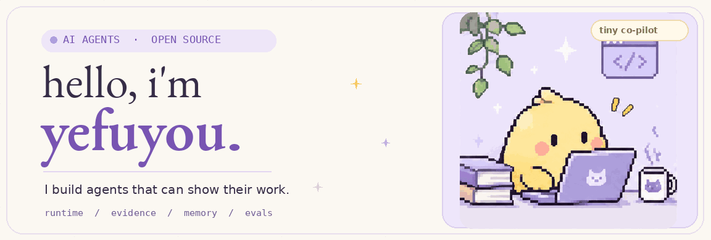

  

  

  
  
  

###  A little about me

I build **AI agents that can explain what they did**, not just return a plausible answer. I'm especially interested in reliable tool use, temporal memory, grounded retrieval, observability, and the engineering details that make AI systems useful beyond a demo.

I enjoy turning complex agent ideas into **clear, inspectable products**.

### 🌱 Things I'm building

| Project | The idea |
| :-- | :-- |
| **[LinkLoom](https://github.com/yefuyou/linkloom)**  Python · AI Agent · Temporal memory | **What did we decide, and when did it change?** An agent that follows decisions and tasks across meetings, connects their history, and keeps evidence and human review attached to important changes. |
| **[Real Raise](https://github.com/yefuyou/real-raise)**  TypeScript · Cloudflare Workers | **Make the numbers make sense.** An income and purchasing-power tool that keeps its calculations deterministic and AI explanations optional. |

  

### 🌸 Little open-source wins

| Project | Contribution |
| :-- | :-- |
| **[PR-Agent](https://github.com/The-PR-Agent/pr-agent)** | [Merged PR #2589](https://github.com/The-PR-Agent/pr-agent/pull/2589): made files excluded from large-PR reviews visible, so people know what the model did *not* inspect. |
| **[Alibaba ANOLISA · AgentSight](https://github.com/alibaba/anolisa)** | 5 merged PRs on agent observability, including TTFT / TPS / TPOT, end-to-end latency, Agent Health percentiles and localization. [Explore contributions](https://github.com/alibaba/anolisa/pulls?q=is%3Apr+author%3Ayefuyou). |
| **[Qwen Code](https://github.com/QwenLM/qwen-code)** | [Merged PR #8953](https://github.com/QwenLM/qwen-code/pull/8953): improved Windows file links in session exports and the VS Code companion. |

### 🧁 My engineering palette

  

  <code>Agent Runtime</code> &nbsp; <code>Tool Integration</code> &nbsp; <code>RAG</code> &nbsp; <code>Temporal Memory</code> &nbsp; <code>Evaluation</code> &nbsp; <code>Observability</code>

  

