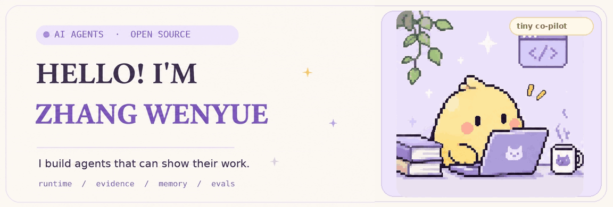
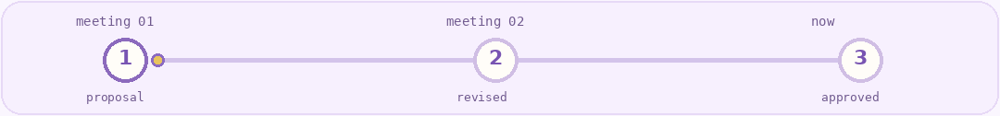
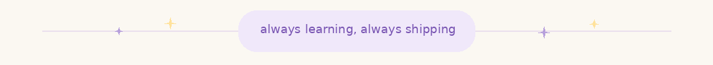

  

  

  
  
  

###  A little about me

I'm **Zhang Wenyue**. I build **AI agents and developer tools that keep decisions, tool calls, and evidence easy to inspect**.

My work spans agent runtimes, temporal memory, retrieval, and evaluation—from following a decision across meetings to keeping review findings consistent across reruns. I like taking these systems all the way through to a usable interface.

### 🌱 Building [LinkLoom](https://github.com/yefuyou/linkloom)

**What is agreed now, who owns it, and what changed?** A local-first meeting memory tool that connects decisions, task handoffs, and deadlines to their source quotes. AI extracts drafts; human review makes them official.

Current and historical lookups use local temporal records. Bounded, read-only agents investigate the harder “why” questions with hybrid retrieval. A review workbench and read-only MCP tools bring the evidence into everyday use.

AI Agents · RAG · Tool Calling · Context Engineering · Agent Evaluation · Agent Observability

  

### 🌸 Open-source contributions

**[PR-Agent](https://github.com/The-PR-Agent/pr-agent)** · merged

Keep review findings consistent across reruns, preserving active issues when coverage is incomplete ([#2722](https://github.com/The-PR-Agent/pr-agent/pull/2722)). Also surfaced files excluded by token budgets ([#2589](https://github.com/The-PR-Agent/pr-agent/pull/2589)) and documented local Git workflows ([#2665](https://github.com/The-PR-Agent/pr-agent/pull/2665)).

**[OpenDirector](https://github.com/ThinkFlowLab/OpenDirector)** · merged

Persist the link from an Agent turn and tool call to its generation jobs, then expose job status, results, and errors in the trace UI—even after runtime traces are gone ([#374](https://github.com/ThinkFlowLab/OpenDirector/pull/374)).

**[ANOLISA · AgentSight](https://github.com/agentic-os-org/ANOLISA)** · 5 merged PRs

LLM latency and throughput metrics, per-agent percentiles, dashboard localization, and follow-up fixes: [#2334](https://github.com/agentic-os-org/ANOLISA/pull/2334), [#2578](https://github.com/agentic-os-org/ANOLISA/pull/2578), [#2583](https://github.com/agentic-os-org/ANOLISA/pull/2583), [#2586](https://github.com/agentic-os-org/ANOLISA/pull/2586), [#2590](https://github.com/agentic-os-org/ANOLISA/pull/2590).

**[Qwen Code](https://github.com/QwenLM/qwen-code)** · merged

Improved Windows file-link handling in session exports and the VS Code companion ([#8953](https://github.com/QwenLM/qwen-code/pull/8953)).

### 🧁 My engineering palette

  

  <code>Agent Runtime</code> &nbsp; <code>MCP</code> &nbsp; <code>Hybrid Retrieval</code> &nbsp; <code>Temporal Memory</code> &nbsp; <code>Evaluation</code> &nbsp; <code>Observability</code>

  

