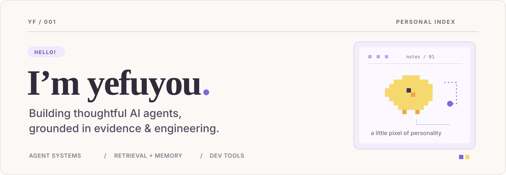

  

  <a href="#selected-work">Selected work</a>&nbsp; · &nbsp;<a href="#open-source-contributions">Open source</a>&nbsp; · &nbsp;<a href="#what-i-work-with">What I work with</a>

I build **AI agents and developer tools** with an interest in what happens *after* a model produces an answer: which tools ran, what evidence supports the result, and whether a failed run can be understood and recovered.

My current focus is **agent runtime engineering**, **retrieval & temporal memory**, and **evaluation & observability**.

---

## Selected work

### 01 / [LinkLoom](https://github.com/yefuyou/linkloom) · AI Agent · Python

**From meeting notes to decisions you can trace.**

A local-first agent for following decisions and action items **across meetings**. It keeps proposals separate from approved decisions, tracks what was true *when*, and grounds investigations in inspectable source evidence.

`Agent runtime` · `Retrieval` · `Temporal memory` · `Evidence grounding` · `Human review`

### 02 / [Real Raise](https://github.com/yefuyou/real-raise) · Web app · TypeScript

**A clearer way to think about money over time.**

An income and purchasing-power calculator built with Cloudflare Workers. Deterministic financial calculations stay separate from optional AI explanations.

`TypeScript` · `Cloudflare Workers` · `AI-assisted explanation`

---

## Open source contributions

### [The-PR-Agent / pr-agent](https://github.com/The-PR-Agent/pr-agent) · merged contribution

Improved the visibility of files omitted during large-PR reviews due to token budgets, so reviewers can see what the model did **not** inspect. [PR #2589](https://github.com/The-PR-Agent/pr-agent/pull/2589)

### [Alibaba / ANOLISA AgentSight](https://github.com/alibaba/anolisa) · 5 merged contributions

Worked on **LLM and agent observability**: latency and throughput metrics (TTFT, TPS, TPOT, end-to-end latency), Agent Health breakdowns, internationalization, and follow-up fixes.

Explore the merged PRs

- [#2334](https://github.com/alibaba/anolisa/pull/2334) · Dashboard localization (English / Simplified Chinese)
- [#2578](https://github.com/alibaba/anolisa/pull/2578) · LLM latency and throughput metrics, from capture to APIs
- [#2583](https://github.com/alibaba/anolisa/pull/2583) · Lint and documentation follow-ups
- [#2586](https://github.com/alibaba/anolisa/pull/2586) · Per-agent latency percentiles in Agent Health
- [#2590](https://github.com/alibaba/anolisa/pull/2590) · Case-insensitive agent-name aggregation

### [Qwen Code](https://github.com/QwenLM/qwen-code) · merged contribution

Improving Windows file-link handling in session exports and the VS Code companion. [PR #8953](https://github.com/QwenLM/qwen-code/pull/8953)

---

## What I work with

**Languages & platforms** &nbsp; `Python` `TypeScript` `Rust` `Cloudflare Workers`

**Agent engineering** &nbsp; `Tool calling` `Agent runtime` `Retrieval & RAG` `Memory` `Evals` `Observability`

**Engineering values** &nbsp; *Clear evidence. Predictable behavior. Useful tools.*

  Built with a little purple, a little pixel art, and a lot of curiosity. ✳

